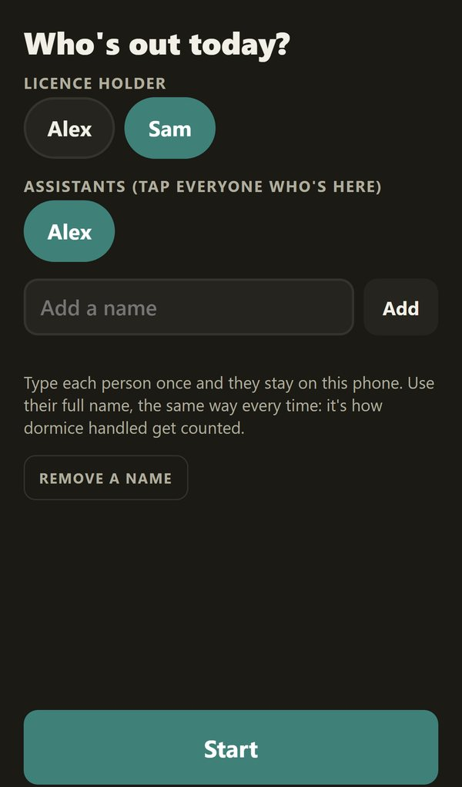
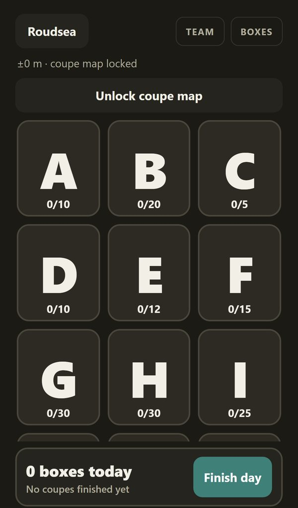

# Box Check

A phone app for dormouse box checks: pick a coupe, tap a box, answer with big buttons. Built for
gloves, rain and people shouting box numbers.

 

- **Works offline** once opened (add it to the Home Screen).
- **Saves every tap on the phone**, including a half-filled dormouse, and warns if a day was never exported.
- **Exports the day as a CSV**, one row per box or per dormouse in NDMP sheet order, through the phone's
  share sheet. The CSV goes into ArcGIS Online with Append.

**Box numbers and coupes are built in (Roudsea); box locations never go in this repo.** It's public.
A different list (another site, boxes added or moved) can be loaded on the phone from a CSV with `box`
and `coupe` columns. "Try example boxes" gives fake boxes for practice.

One file (`index.html`), no build step, no server. `sw.js` caches it for offline use.
